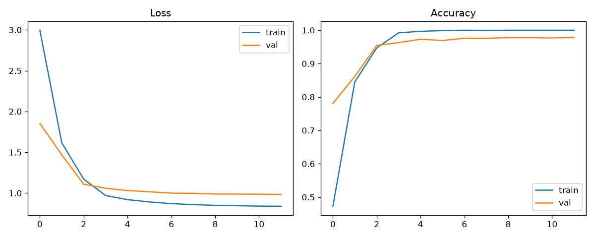

# Oxford Flowers Classifier

用遷移學習（ResNet18）辨識 102 種花卉，test 準確率 **97.7%**。
這是我的第一個深度學習作品集專案，目的是完整走過「資料 → 訓練 → 驗證 → 測試 → 版本控管」的流程。

## 成果

| 指標 | 數值 |
|---|---|
| 驗證準確率（val） | 97.9% |
| 測試準確率（test） | 97.7% |
| 訓練時間 | 約 10 分鐘（RTX 3070 8GB，12 epochs） |



## 方法

- **模型**：ResNet18（ImageNet 預訓練），把最後一層換成 102 類輸出
- **兩階段微調**：前 2 個 epoch 凍結骨幹、只訓練輸出層；之後解凍全部，學習率降為 1/10
- **資料增強**：隨機裁切、水平翻轉、色彩抖動（只用於訓練集）
- **混合精度（AMP）**：fp16 訓練，節省顯存並加速
- **Label smoothing 0.1**
- **資料切分**：train 6093 / val 1076 / test 1020。test 集只在最後評估一次

## 結果觀察

- 解凍骨幹後 val acc 從 86% 直接躍升到 95%，顯示微調全部參數的效果明顯
- train acc 達 100%、val 約 97.8%，有輕微過擬合，但差距小

## 資料集

[nkirschi/oxford-flowers](https://huggingface.co/datasets/nkirschi/oxford-flowers)（Hugging Face）。
授權請見資料集頁面：（填入 License）

## 如何執行

​```bash
python -m venv .venv
.venv\Scripts\activate
python -m pip install -r requirements.txt
python train.py
​```
資料集會自動從 Hugging Face 下載。

## 環境

Python 3.x、PyTorch（CUDA 12.6）、RTX 3070 8GB、Windows

## 之後要做

- [ ] `predict.py`：單張圖片推論，輸出前三名預測
- [ ] `evaluate.py`：混淆矩陣與錯誤案例分析
- [ ] 對照實驗：凍結 vs 不凍結、有無資料增強
- [ ] 換成自己熟悉的主題資料集
- [ ] FastAPI + 前端 Demo